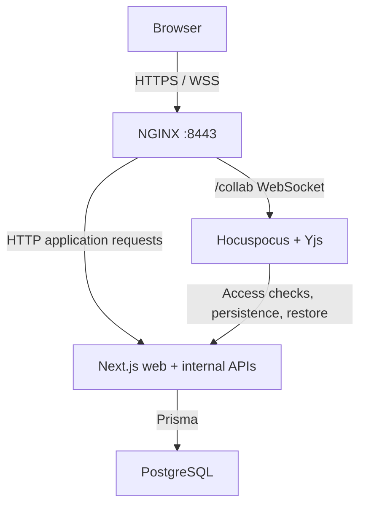
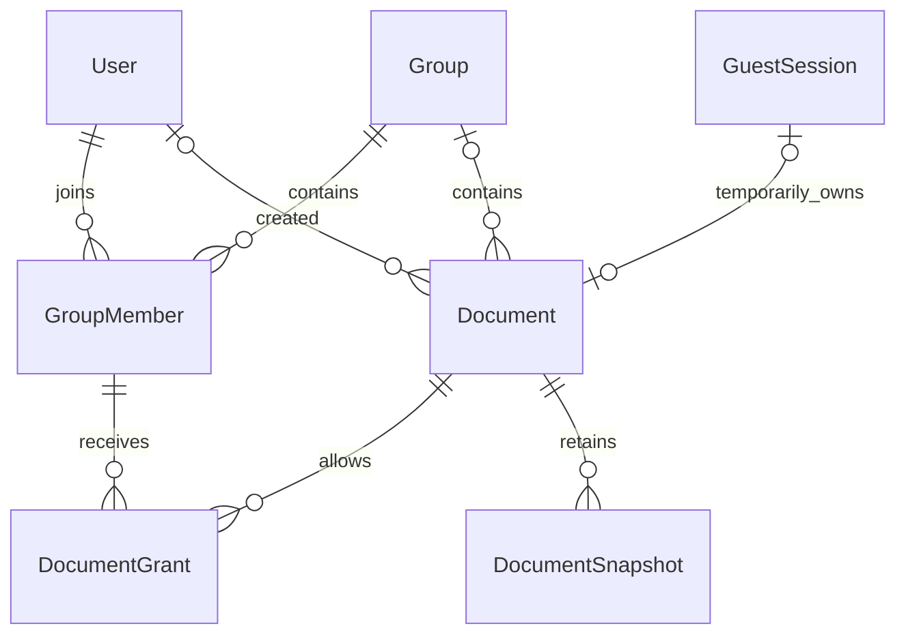

*This project has been created as part of the 42 curriculum by kmurugan, tmurua, uponci, hruiz-fr, and gzanin.*

# SyncText

## Description

**SyncText** is a shared space to write notes, drafts, ideas, or any text together, instantly. It is a collaborative document editor where you can start writing even without an account. If you decide it is useful, register and keep what you wrote. Otherwise, leave it behind.

SyncText runs its own authentication, collaboration, persistence, and database on infrastructure you control. Documents are stored and synchronized inside the application rather than relying on an external document platform.

Registered users receive a **Private Space** for their documents. Shared documents use group membership and document-level access rules: groups distinguish **Owner**, **Admin**, and **Member** responsibilities, while document access distinguishes who may view or edit content.

Key implemented features include:

- secure email/password authentication, email verification, and password reset;
- temporary guest documents that can be claimed after sign-in;
- document creation, listing, renaming, deletion, and access control;
- real-time collaborative editing with shared cursors over WebSockets;
- PostgreSQL persistence for collaborative Yjs state;
- automatic document snapshots with history, preview, and restore;
- private spaces, shared-group membership, and document grants;
- responsive shared UI components;
- Privacy Policy, Terms of Service, Cookies, and Accessibility pages.

## Instructions

### Prerequisites

- Docker Engine or Docker Desktop
- Docker Compose v2 (`docker compose`)
- GNU Make
- OpenSSL with support for `req -addext`
- Ports `8443` and `8025` available
- Latest stable Google Chrome

Node.js 22 and npm are only required on the host for optional local development checks. The standard application workflow runs through Docker.

### Configuration

No manual configuration is required for the default local setup.

On the first startup, `make` automatically:

1. creates `.env` from `.env.example`,
2. generates random local values for `DB_PASSWORD` and `INTERNAL_SERVICE_TOKEN`,
3. creates a self-signed TLS certificate under `secrets/`.

Existing `.env` and TLS files are preserved on later runs.

The default local configuration uses:

| Variable | Local value / purpose |
|---|---|
| `DOMAIN_NAME` | `localhost`, used for the TLS certificate and NGINX host |
| `APP_URL` | `https://localhost:8443`, used in application links |
| `NODE_ENV` | `production`, matching the container runtime |
| `DB_NAME`, `DB_USER` | `synctext` |
| `DB_PASSWORD` | Randomly generated on first startup |
| `INTERNAL_SERVICE_TOKEN` | Randomly generated on first startup |
| `MAILPIT_URL` | `http://mailpit:8025`, the internal development mail service |

`.env`, generated credentials, and TLS private keys remain local and are ignored by Git.

### Start the application

From the repository root, build and start the complete application with one command:

```sh
make
```

This prepares missing local configuration, builds the Docker images, starts PostgreSQL, applies database migrations, starts Next.js and Hocuspocus, and exposes browser traffic through NGINX over HTTPS/WSS.

Open:

```text
https://localhost:8443
```

The local TLS certificate is self-signed, so the browser may show a certificate warning on first access.

For development email verification and password-reset messages, open Mailpit at:

```text
http://127.0.0.1:8025
```

### Useful commands

| Command | Purpose |
|---|---|
| `make ps` | Show container status |
| `make logs` | Follow service logs |
| `make down` | Stop the stack while keeping project data volumes |
| `make up` | Rebuild and start the stack |
| `make migrate-dev NAME=description` | Create a development Prisma migration |
| `make typecheck` | Run workspace type checks |
| `make lint` | Run the configured lint checks |

`make fclean` and `make re` remove project data volumes. Use them only when a clean local database is intended.

Development fixtures and the migration/seed workflow are documented in [DEV.md](DEV.md).

## Resources

### Technical references

- [Next.js](https://nextjs.org/docs)
- [React](https://react.dev/learn)
- [TypeScript](https://www.typescriptlang.org/docs/)
- [Tiptap](https://tiptap.dev/docs/editor/getting-started/overview)
- [Yjs](https://docs.yjs.dev/)
- [Hocuspocus](https://tiptap.dev/docs/hocuspocus/getting-started/overview)
- [Prisma](https://www.prisma.io/docs)
- [PostgreSQL 16](https://www.postgresql.org/docs/16/)
- [Docker Compose](https://docs.docker.com/compose/)
- [NGINX WebSocket proxying](https://nginx.org/en/docs/http/websocket.html)
- [shadcn/ui](https://ui.shadcn.com/docs)
- [Base UI](https://base-ui.com/react/overview/quick-start)
- [Mailpit](https://mailpit.axllent.org/docs/)
- [OWASP Password Storage Cheat Sheet](https://cheatsheetseries.owasp.org/cheatsheets/Password_Storage_Cheat_Sheet.html)

### AI usage

AI tools were used as development assistance for explaining unfamiliar framework and infrastructure concepts, reviewing code changes, investigating bugs and integration problems, planning tests, and assisting with snapshot/versioning and documentation work.

AI-generated suggestions were treated as proposals rather than authoritative output. Changes were reviewed against the repository and validated through code review, type checking, linting, and manual testing where applicable.

## Team Information

All five team members are developers. Additional roles describe coordination responsibilities rather than exclusive ownership of a feature.

| Member | 42 login | Role(s) | Responsibilities |
|---|---|---|---|
| Kiruthika Murugananthan | `kmurugan` | Product Owner, Developer | Product requirements, authentication, session security, legal pages |
| Tom Murua | `tmurua` | Project Manager / Scrum Master, Developer | Team coordination, infrastructure, persistence, snapshots, documentation |
| Umberto Ponci | `uponci` | Technical Lead / Architect, Developer | Technical direction, application/editor integration, document APIs, CI |
| Harold Ruiz-Franck | `hruiz-fr` | Developer | Database architecture, collaboration service, permissions, group model |
| Gianluca Zanin | `gzanin` | Developer | Frontend layout, shared components, responsive navigation, dashboard and auth UI |

## Project Management

The team organizes work through GitHub Issues, feature branches, and pull requests. Responsibilities are assigned by area, while implementation and review can involve multiple members.

The team holds regular planning and progress meetings. WhatsApp is used for day-to-day coordination, while meetings take place in person or through Google Meet. GitHub is used to track tasks, implementation, code review, and integration.

The main responsibility areas are:

- **Product and requirements:** Kiruthika
- **Project coordination and infrastructure:** Tom
- **Technical architecture:** Umberto
- **Database and collaboration architecture:** Harold
- **Frontend and responsive UI:** Gianluca

All team members contribute through implementation, review, testing, and documentation.

## Technical Stack

| Area | Technology | Purpose and reason for the choice |
|---|---|---|
| Web application | Next.js 16.3.1, React 19.2.8, TypeScript 5.9.3 | Provides frontend pages and backend route handlers in one TypeScript application |
| Editor | Tiptap 3.30.2 | Extensible rich-text editor with Yjs collaboration support |
| Collaboration | Yjs 13.6.32, Hocuspocus 4.6.0 | Handles concurrent document state and real-time WebSocket synchronization |
| Database | PostgreSQL 16, Prisma 7.9.1 | Relational data model, typed queries, migrations, transactions, and binary document-state storage |
| UI | Tailwind CSS 4.3.3, shadcn/Base UI, custom CSS, Lucide icons | Reusable UI primitives and responsive styling |
| Authentication | Argon2id, Zod, zxcvbn, opaque session tokens | Secure password hashing, input validation, password strength estimation and revocable server-side sessions |
| Runtime and deployment | Node.js 22, Docker Compose, NGINX | Reproducible builds and a single HTTPS/WSS entry point |
| Development email | Mailpit | Local inspection of verification and password-reset emails |

### Architecture



The collaboration service uses authenticated internal Next.js endpoints for access checks, persistence, and restore coordination. It does not connect directly to PostgreSQL. Browser traffic uses HTTPS/WSS through NGINX, while service-to-service traffic stays inside the Docker Compose networks.

| Service | Responsibility |
|---|---|
| `nginx` | TLS termination and routing to the web and collaboration services |
| `web` | UI, authentication, document APIs, permissions, and database access |
| `collab` | Live Yjs documents, connection authorization, persistence, and restore coordination |
| `db` | PostgreSQL storage |
| `migrate` | Applies Prisma migrations before the web service starts |
| `mailpit` | Captures local development email |
| `guest-cleanup` | Removes expired, unclaimed guest sessions and documents |

The repository uses npm workspaces:

- `synctext/` for the Next.js application;
- `services/collab/` for the collaboration service;
- `packages/db/` for Prisma and database helpers;
- `packages/shared/` for shared types and constants.

## Database Schema

The database schema is defined in `packages/db/prisma/schema.prisma`. SQL migrations enforce additional constraints where Prisma's schema language is not sufficient.



| Model | Important fields and types | Relationships / purpose |
|---|---|---|
| `User` | `id`, `email`, `username`: `String`; `passwordHash`, `avatarUrl`: `String?`; `role`: `PlatformRole` | Accounts, memberships, sessions, auth tokens, friendship pairs |
| `Group` | `id`, `name`: `String`; `isPrivateSpace`: `Boolean`; timestamps | Contains members and documents |
| `GroupMember` | `id`, `groupId`, `userId`: `String`; `role`: `GroupRole`; `joinedAt`: `DateTime` | Connects users to groups; a group/user pair is unique |
| `Document` | `id`, `title`: `String`; `ystate`: `Bytes?`; `groupId`, `guestSessionId`, `createdById`: `String?` | Stores document metadata and persisted collaborative state |
| `DocumentGrant` | `membershipId`, `documentId`: `String`; `createdAt`: `DateTime` | Gives one group membership edit access to one document |
| `DocumentSnapshot` | `id`, `documentId`: `String`; `ystate`: `Bytes`; `createdAt`: `DateTime` | Stores historical Yjs document states |
| `GuestSession` | `id`, `tokenHash`: `String`; expiry dates: `DateTime` | Owns one temporary unclaimed guest document |
| `Friendship` | `userAId`, `userBId`, `requestedById`: `String`; `status`: `FriendshipStatus`; `respondedAt`: `DateTime?` | Stores canonical friendship/request pairs |
| `Session` | `id`, `userId`, `tokenHash`: `String`; expiry/revocation/activity dates | Server-side authenticated sessions |
| `EmailVerificationToken` | `id`, `userId`, `tokenHash`: `String`; `expiresAt`: `DateTime`; `usedAt`: `DateTime?` | Email verification |
| `PasswordResetToken` | `id`, `userId`, `tokenHash`: `String`; `expiresAt`: `DateTime`; `usedAt`: `DateTime?` | Password reset |

Main enums:

- `PlatformRole`: `USER`, `ADMIN`
- `GroupRole`: `OWNER`, `ADMIN`, `MEMBER`
- `FriendshipStatus`: `PENDING`, `ACCEPTED`, `DECLINED`

### Document access model

For documents belonging to a group:

- every group member can view the group's documents;
- the group `OWNER` can edit, rename, and delete them;
- other members require a `DocumentGrant` for edit-level actions;
- creating a document gives its creator a grant through their membership;
- `createdById` records who created the document but does not itself grant access;
- a non-member receives `404`, while a member attempting a forbidden write receives `403`;
- the platform `ADMIN` role does not bypass document permissions.

The same permission model is used by document APIs and collaboration access checks.

## Features List

| Feature | Functionality | Contributor(s) |
|---|---|---|
| Registration and authentication | Validates input, hashes passwords with Argon2id, verifies email, signs users in/out, and supports password reset | Kiruthika; Gianluca for auth UI; Umberto for later UI integration |
| Session handling | Hashed server-side tokens, secure cookies, expiry/revocation, activity checks, and cross-tab updates | Kiruthika |
| Document dashboard | Create, list, open, rename, delete, search, and sort accessible documents | Umberto, Gianluca, Harold |
| Collaborative rich-text editing | Shared Tiptap/Yjs content, live cursors/participants, connection status, and synchronized document updates | Harold, Umberto; Kiruthika for connection authorization |
| Persistent document state | Saves and reloads binary Yjs state through internal APIs and PostgreSQL | Tom, Harold |
| Automatic snapshots | Stores bounded historical document states with serialized writes and retention | Tom |
| Snapshot history and preview | Lists recent snapshots and opens an isolated read-only preview | Tom |
| Snapshot restore | Restores an earlier snapshot through the collaboration service, creates a recovery snapshot first, and updates connected clients live | Tom |
| Group permission foundation | Private spaces, shared-group membership, document grants, centralized read/write checks, and viewer mode | Harold; Kiruthika for collaboration access rechecks |
| Temporary guest documents | Creates or resumes a guest document, limits its lifetime, claims it into a private space after sign-in, and removes expired unclaimed documents | Umberto; Harold and Kiruthika for permission/collaboration integration |
| Shared and responsive UI | Reusable controls, auth/dashboard layouts, mobile navigation, dialogs, and reduced-motion handling | Gianluca, Umberto |
| Legal information pages | Privacy Policy, Terms of Service, Cookies, and Accessibility pages linked from the application | Kiruthika |
| Local deployment and validation | Docker Compose setup, HTTPS/WSS routing, migration/readiness ordering, CI build/lint checks, and local validation commands | Tom, Harold, Umberto, Kiruthika |

### Snapshot behavior

Changed collaborative content is persisted as binary Yjs state. Automatic snapshots retain previous document states while avoiding duplicate writes and unbounded history.

Snapshot previews use a separate temporary `Y.Doc`, so viewing history does not change the live document.

Authorized editors can restore a previous snapshot. Before restoration, the current state is stored as a recovery snapshot. Restoration is coordinated through the collaboration service so connected clients converge on the restored state without requiring a page refresh.

### Guest document lifetime

An unauthenticated visitor can edit for 30 minutes, followed by a five-minute read-only period. Signing in before expiry claims the document into the user's private space. Expired, unclaimed documents are removed by the periodic cleanup service.

## Modules

Major modules are worth 2 points and Minor modules 1 point. The selected module set totals **15 points: 4 Major × 2 + 7 Minor × 1**.

| Module | Type | Points | Justification and implementation | Contributor(s) |
|---|---|---:|---|---|
| Framework for frontend and backend | Major | 2 | Next.js provides both React frontend capabilities and backend route handlers in one TypeScript application | Umberto; all developers contribute to the application |
| Real-time features using WebSockets | Major | 2 | Hocuspocus/Yjs WebSocket connections synchronize document changes, connection state, and access changes across clients | Harold, Kiruthika, Tom, Umberto |
| Real-time collaborative features | Minor | 1 | Tiptap and Yjs provide simultaneous editing, shared state, cursors, and read-only participation | Harold, Umberto, Kiruthika, Tom |
| Public API to interact with the database | Major | 2 | Selected to expose secured external access to application data. The current document APIs provide part of the foundation; the complete module requires API-key security, rate limiting, documentation, and the required endpoint/method coverage | Umberto |
| Standard user management and authentication | Major | 2 | Selected to support user identity and social collaboration. Secure account/session flows and profile/friendship foundations exist; full profile/avatar persistence, complete friend flows, online status, and profile pages are required for completion | Umberto, Kiruthika, Gianluca, Harold |
| ORM | Minor | 1 | Prisma provides typed database access, relations, migrations, and transaction support over PostgreSQL | Harold; used across the backend |
| Complete notification system | Minor | 1 | Selected for user-facing document, group, and social events. Authentication emails are separate from this module | Kiruthika |
| OAuth 2.0 | Minor | 1 | Selected to provide an alternative remote authentication method in addition to local email/password authentication | Kiruthika |
| Custom design system | Minor | 1 | Reusable controls, shared visual rules, typography, icons, and component structure provide the basis for a consistent custom interface | Gianluca, Umberto |
| Additional browsers | Minor | 1 | Selected to provide full application compatibility with at least two browsers in addition to Chrome | Harold |
| Health checks, status, backups, and disaster recovery | Minor | 1 | Docker health checks monitor the main services and `/status` shows their current availability. PostgreSQL is backed up automatically to a separate persistent volume with limited retention, and backups can be created, listed, and restored through the Makefile | Tom |

## Individual Contributions

### Kiruthika (`kmurugan`)

- Product Owner and developer for registration, validation, password hashing, sessions, logout/reset, and email verification.
- Implemented collaboration authentication, permission/session rechecks, and dashboard/session protection.
- Implemented the legal information pages and contributed development validation tooling.
- Contributes to the framework, WebSocket, and user-management modules.

**Technical challenge:** a collaboration connection can outlive a user's session or permission. Server-side verification and repeated access checks restrict or close the connection when access changes.

### Tom (`tmurua`)

- Project Manager / Scrum Master and developer for Docker Compose, configuration, HTTPS, container/network setup, and service health checking.
- Implemented binary collaborative-state persistence, automatic snapshots, snapshot history/preview, and snapshot restore.
- Coordinates reviews and integration and maintains the project README.
- Contributes to the framework, WebSocket, and real-time collaboration modules and is responsible for the health/backups/recovery module.

**Technical challenge:** persistence and restore operations must not race with concurrent collaborative edits. Database locking, serialized writes, document locking during restore, recovery snapshots, and collaboration-aware restoration keep history and live document state consistent.

### Umberto (`uponci`)

- Technical Lead / Architect and developer for application/editor integration, document/dashboard APIs, and temporary guest-document behavior.
- Implemented CI build/lint validation and contributed component, navigation, homepage, and authentication integration.
- Contributes to the framework, public API, and user-management modules.

**Technical challenge:** a temporary guest document must become a normal private document after sign-in without losing content. The claim flow changes ownership transactionally before removing the guest session.

### Harold (`hruiz-fr`)

- Developer for Prisma workspaces, migrations/schema, development fixtures, Hocuspocus/WebSocket infrastructure, and Tiptap/Yjs collaboration.
- Implemented viewer/access behavior, synchronization fixes, the group/private-space data model, and centralized permissions.
- Responsible for the WebSocket, real-time collaboration, ORM, and additional-browser modules.

**Technical challenge:** document access must survive changes in who originally created a document. Centralized group-owner and membership-grant rules keep authorization tied to the group rather than to a creator-only ownership model.

### Gianluca (`gzanin`)

- Developer for frontend layout, authentication UI, document actions, user menu, reusable components, mobile navigation, and dashboard/profile presentation.
- Implemented responsive dialogs and controls, frontend type fixes, and platform/build compatibility improvements.
- Responsible for the custom design-system module and contributes to the framework and account UI.

**Technical challenge:** long document titles and dense controls can break smaller layouts. Title truncation/tooltips and responsive navigation preserve usability while keeping the complete title accessible.
